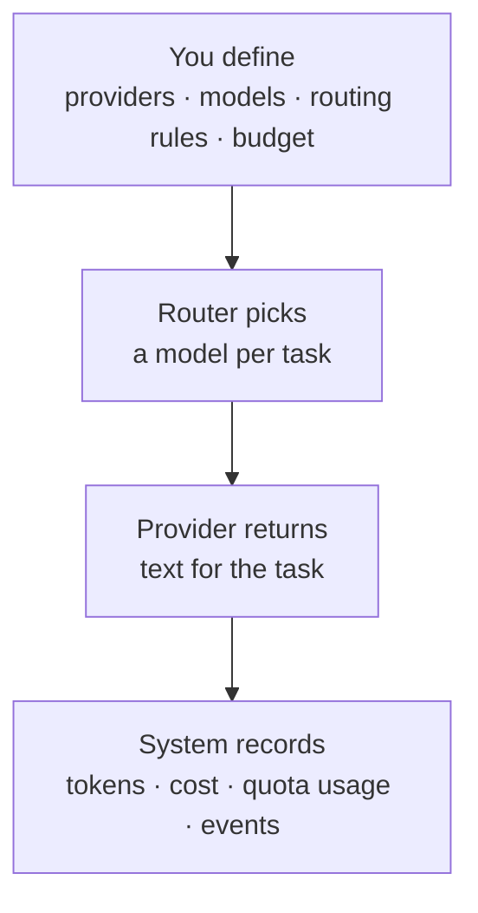
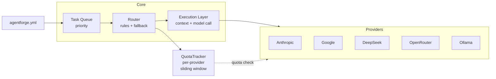

# AgentForge

**Multi-agent orchestration platform with cost control, quota management, and intelligent model routing.**

AgentForge takes tasks from a priority queue and picks a model for each one with rules from `agentforge.yml`. It sends one prompt per task to that model and stores the text that comes back. On that path it enforces per-provider rate limits and a per-project budget. A REST API, a WebSocket feed, and a React dashboard show the queue, quotas, costs, and events.



## Status

AgentForge is being reoriented. Today one path works end to end: a task enters the queue, the router picks a model, the provider makes one call, and the result text is stored. Agents do not edit files, run commands, or use git. The new direction is a self-hosted control panel for coding agents that work on real repositories. [ROADMAP.md](ROADMAP.md) describes the plan, and the [AgentForge Roadmap project](https://github.com/users/sinsonido/projects/4) tracks the work.

Some modules exist in `src/`, but nothing starts them:

- `src/git/` (`GitManager`, `BranchStrategy`, `AutoCommit`, `AutoPR`, `ReviewGate`, `GitHubIntegration`)
- `src/plugins/` (`PluginManager` is never instantiated)
- `src/execution/inter-agent-comm.js`, `parallel-execution.js`, `review-workflow.js`, and `task-decomposition.js`

These modules are present but not wired. They are scheduled for removal in v0.9 (see [#190](https://github.com/sinsonido/agentforge/issues/190)).

## What works today

- **Model routing.** Rules match on task type, estimated context size, or remaining budget. A rule names a model to force, a preferred model with fallbacks, or a tier. If no rule matches, the router takes the cheapest available model in the tier for the task type, then tries lower tiers.
- **Quota tracking.** Each provider with a `quota` block gets a sliding window for requests and input tokens. Above 70% usage the provider is `throttled`. Above 95% it is `exhausted` and the router skips it. Tasks that find no model wait in `waiting_quota` and return to the queue on the `quota.reset` event. See [docs/providers.md](docs/providers.md#provider-priority-and-fallback) for when that event fires.
- **Budget control.** The orchestrator records the cost of every call. At 80% of the project budget it emits `budget.warning`. At 95% it moves queued tasks to `paused_budget`. The `alerts` section of the config sets both thresholds.
- **Providers.** Anthropic, Google (Gemini), DeepSeek, OpenRouter, and Ollama for local models. Each call is a single request with no streaming and no tool use.
- **Persistence.** SQLite (`better-sqlite3`, WAL mode) at `.agentforge/data.db` stores executed tasks, cost records, events, and agent activity. The task queue lives in memory, so a restart drops tasks that have not run.
- **Dashboard and API.** An Express REST API and a WebSocket feed on port 4242, optional Bearer-token auth, and a React dashboard with dashboard, Kanban, agents, providers, and costs views.

## Quick Start

AgentForge needs Node.js 24. It is not published to npm, so run it from a clone:

```bash
git clone https://github.com/sinsonido/agentforge.git
cd agentforge
npm install

# Optional: build the React dashboard (without it, the server serves the older vanilla UI in src/ui/)
npm run ui:install
npm run ui:build

# Configure
cp agentforge.example.yml agentforge.yml
# Edit with your API keys

# Run
node src/cli.js start
# Dashboard at http://127.0.0.1:4242

# Or use the start script (supports Cloudflare tunnel)
bash scripts/start.sh                    # Normal start
bash scripts/start.sh --tunnel           # Expose via Cloudflare tunnel (prints URL only)
bash scripts/start.sh --tunnel --verbose # Full logs + tunnel URL highlighted
bash scripts/start.sh --help             # All options

# npm shortcuts
npm start                   # Normal start
npm run start:tunnel        # Start + Cloudflare tunnel
npm run start:verbose       # Start with verbose output
npm run start:tunnel:verbose
```

The tunnel makes the server reachable from the internet. Turn on `server.auth` in `agentforge.yml` before you use it. See [docs/configuration.md](docs/configuration.md#server).

## Architecture



See [docs/architecture.md](docs/architecture.md) for the full design.

## Configuration

Everything is configured in `agentforge.yml`:

```yaml
project:
  name: "My Project"
  budget: 50.00

providers:
  anthropic:
    api_key: ${ANTHROPIC_API_KEY}
    quota:
      max_requests_per_minute: 100
      auto_pause: true
  ollama:
    endpoint: http://localhost:11434

routing:
  rules:
    - match: { type: [architecture, planning] }
      tier: 1
      prefer: claude-opus-5-5
    - match: { type: [implement, refactor] }
      tier: 2
      prefer: claude-sonnet-5-5
    - match: { type: [test, script, bulk] }
      tier: 3
      prefer: codestral:22b

team:
  - name: Architect
    model: claude-opus-5-5
    system_prompt_file: prompts/architect.md
  - name: Developer
    model: claude-sonnet-5-5
```

Every model named in `routing` or `team` must also appear under `models`, with its provider, tier, and price. Startup fails if one is missing. See [agentforge.example.yml](agentforge.example.yml) for a full file and [docs/configuration.md](docs/configuration.md) for which keys the code reads.

## Contributing

See [CONTRIBUTING.md](CONTRIBUTING.md). Issues and PRs welcome.

## License

MIT
