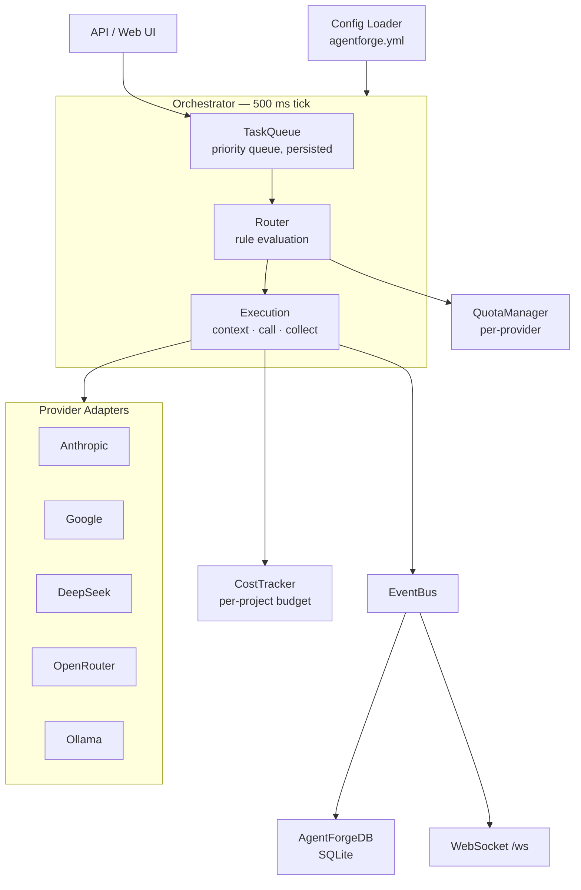
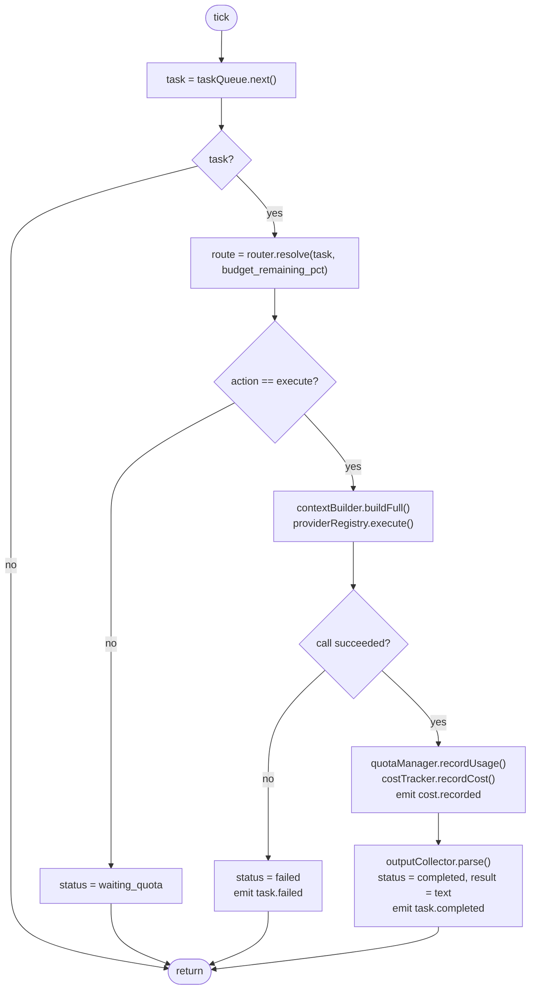
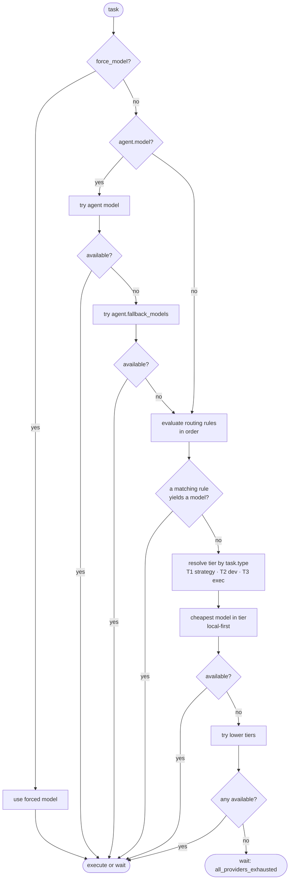
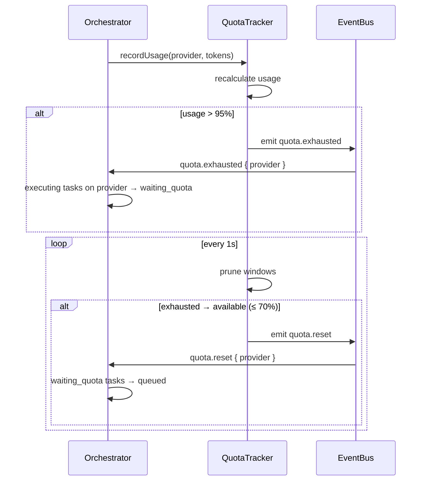
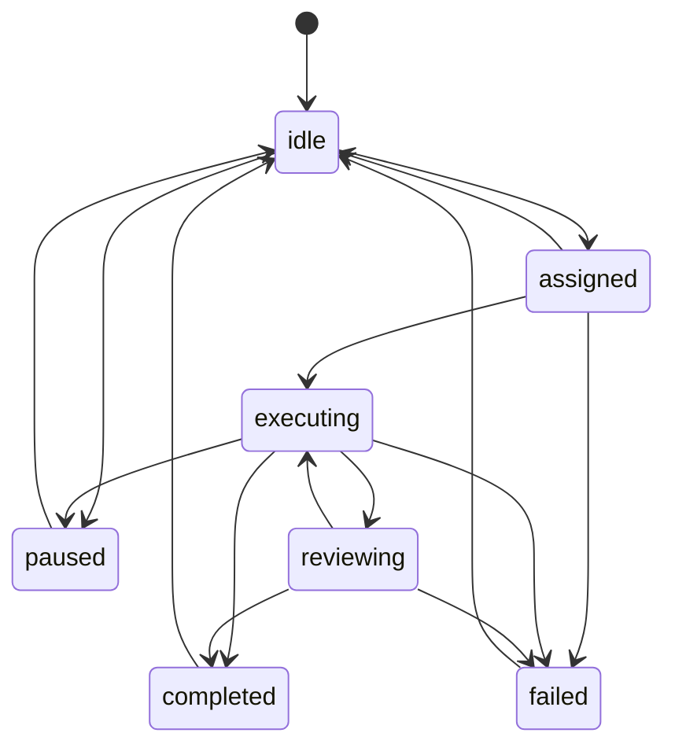

# Architecture

This page describes the code on `master`. One path works end to end: a task enters the queue (persisted in SQLite), the router picks a model, the provider answers one prompt, and the result text is stored. Agents have no tools, so they do not edit files, run commands, or use git.

Several modules exist in `src/` but nothing starts them. [Present but not wired](#present-but-not-wired) lists them. They are scheduled for removal in v0.9 (see [#190](https://github.com/sinsonido/agentforge/issues/190)). [ROADMAP.md](../ROADMAP.md) describes the reorientation.

## Design principles

1. **Deterministic routing.** No AI decides which AI to use. Rules are explicit, auditable, and configurable.
2. **Fail predictably.** If a model's quota is exhausted, the router tries the next candidate. If the budget is spent, queued tasks pause. If a provider call throws, the task fails.
3. **Config as code.** `agentforge.yml` is the source of truth. The server reads it at startup and never writes it.
4. **Agents are configuration.** An agent is a model choice and a system prompt, not a process. There is no memory between tasks.
5. **Everything is an event.** Components report state changes on the event bus. The database, the WebSocket server, and the orchestrator subscribe to it.

## System overview



`createAgentForge()` in `src/index.js` builds every component and returns:

```js
{ orchestrator, taskQueue, router, quotaManager, providerRegistry,
  agentPool, db, eventBus, config, agents, models }
```

The CLI's `start` command calls it, starts the orchestrator, and starts the HTTP server from `src/api/server.js`. The other CLI commands (`task add`, `task list`, `task show`, `status`) call `createAgentForge()` in their own process. They do not reach a running server.

## Component details

### Orchestrator (`src/core/orchestrator.js`)

The main loop. `start()` runs `_tick()` every 500 ms. Each tick starts at most one task.



`_resolveTools()` returns `[]`, so providers never receive tool definitions. There is no review step and no git step after a task completes.

The orchestrator also listens to events:

- `quota.exhausted` moves executing tasks on that provider to `waiting_quota` and emits `agent.paused`.
- `quota.reset` moves every `waiting_quota` task back to `queued` and emits `agent.resumed`.
- `budget.exceeded` moves queued tasks of the project to `paused_budget`. Nothing moves them back automatically.

### TaskQueue (`src/core/task-queue.js`)

An in-memory map of tasks. `next()` returns the `queued` task with the highest priority (`critical`, `high`, `medium`, `low`), oldest first, whose `depends_on` tasks are all `completed`. Every add and status change is written to SQLite at once. On boot the queue reloads its live tasks and the tasks they depend on. Tasks found `executing` become `failed` with result `interrupted`, and `assigned` or `waiting_quota` tasks return to `queued`. Booting twice changes nothing. Task IDs are `t1`, `t2`, and so on, and the counter continues across restarts.

Statuses: `queued`, `assigned`, `executing`, `completed`, `failed`, `waiting_quota`, `paused_budget`.

### Router (`src/routing/router.js`)

Deterministic decision engine. No randomness, no AI.

**Input:** the task (`type`, `agent_id`, `force_model`, `context_tokens_estimate`, `allow_tier_downgrade`) and `budget_remaining_pct`.
**Output:** `{ action: 'execute', model, provider, tier, fallback_used }` or `{ action: 'wait', reason }`.

**Evaluation order:**



A model is available when it is listed under `models`, its `context` fits `context_tokens_estimate`, and `quotaManager.canExecute()` allows its provider. The orchestrator sets `context_tokens_estimate` after routing, so the first routing of a task always sees `0`. The router ignores `routing.fallback_strategy` and `routing.cost_optimization`.

### QuotaManager (`src/core/quota-tracker.js`)

One `ProviderQuotaTracker` per provider that has a `quota` block. Providers without one are never limited.

```
QuotaManager {
  addProvider(providerId, quotaConfig)
  canExecute(providerId, estimatedTokens): boolean
  recordUsage(providerId, tokensIn, tokensOut)
  getStatus(providerId) / getAllStatuses()
  startWatcher(intervalMs = 1000) / stopWatcher()
}

ProviderQuotaTracker {
  requests: SlidingWindow   // max_requests_per_minute
  tokensIn: SlidingWindow   // max_tokens_per_minute (input tokens only)
  state: "available" | "throttled" | "exhausted"
}
```

The window length is `window_minutes` (default 1). Above 70% of either limit the state is `throttled`. Above 95% it is `exhausted`. `auto_pause: false` turns tracking off for that provider.

**Auto-pause flow:**



`quota.reset` fires only on a direct change from `exhausted` to `available`. If the state passes through `throttled` on the way down, no `quota.reset` fires, and waiting tasks stay in `waiting_quota`.

### CostTracker (`src/core/cost-tracker.js`)

The orchestrator creates it and registers the project with `project.budget`. After each call it adds the cost, computed from the model's `cost_in` and `cost_out` per million tokens. At `alerts.budget_warning_pct` it emits `budget.warning`. At `alerts.budget_pause_pct` it emits `budget.exceeded`. Spend lives in memory and resets on restart.

### Provider adapters (`src/providers/`)

Every adapter extends `BaseProvider` and is registered in `createAgentForge()`.

```typescript
interface Provider {
  id: string

  execute(params: {
    model: string
    messages: Message[]   // first message has role "system"
    tools?: Tool[]        // always undefined or [] today
    max_tokens?: number   // agent.max_tokens_per_task, default 4096
    temperature?: number  // default 0.7
  }): Promise<{
    content: string
    tokens_in: number
    tokens_out: number
    tool_calls: ToolCall[]
    finish_reason: string
  }>

  listModels(): Promise<string[]>
  healthCheck(): Promise<boolean>
}
```

No adapter streams. `OllamaProvider` lives in `interface.js` and calls `/api/chat` with `stream: false`.

### Agent definition

Agents are configuration, loaded from `team` by `buildFromConfig()` in `src/config/loader.js`.

```typescript
interface AgentConfig {
  id: string                       // name, lowercased, spaces → "-"
  name: string
  role: string
  model: string | null             // Tried before routing rules
  fallback_models: string[]        // Tried next, in order
  system_prompt: string            // Or loaded from system_prompt_file
  system_prompt_file: string | null
  max_tokens_per_task: number | null

  // Loaded but not read by any running code:
  tools: string[]
  require_review: boolean
  reviewer: string | null
  max_cost_per_task: number | null
  allow_tier_downgrade: boolean
}
```

**Agent lifecycle.** `AgentLifecycle` in `src/core/agent-lifecycle.js` defines the state machine below, and `createAgentForge()` registers one per agent in an `AgentPool`. The orchestrator never calls the transitions, so every agent stays `idle`. The API reads the pool for `GET /api/agents`.



### Event bus (`src/core/event-bus.js`)

An `EventEmitter` singleton that also keeps the last 1000 events in memory. Events emitted by wired code:

```
task.queued          { task }
task.executing       { task, route }
task.completed       { task, cost, route, output }
task.failed          { task, error }
task.status_changed  { taskId, status, changedAt }      (REST API)
quota.throttled      { provider, pct }
quota.exhausted      { provider }
quota.reset          { provider }
agent.paused         { agent, reason }
agent.resumed        { agent }
agent.config_updated { agentId, model, updatedAt }      (REST API)
budget.warning       { projectId, spent, budget, spent_pct }
budget.exceeded      { projectId, spent, budget, spent_pct }
cost.recorded        { projectId, agentId, model, tokensIn, tokensOut, cost }
review.approved      { prNumber, approvedAt }           (REST API, nothing listens)
review.rejected      { prNumber, reason, rejectedAt }   (REST API, nothing listens)
```

## Data model

`AgentForgeDB` (`src/persistence/db.js`) opens `.agentforge/data.db` (or `database.path`) in WAL mode and creates these tables on startup:

```sql
CREATE TABLE IF NOT EXISTS tasks (
  id TEXT PRIMARY KEY,
  title TEXT NOT NULL,
  type TEXT,
  status TEXT,
  agent_id TEXT,
  project_id TEXT,
  model_used TEXT,
  tokens_in INTEGER DEFAULT 0,
  tokens_out INTEGER DEFAULT 0,
  cost REAL DEFAULT 0,
  result TEXT,
  created_at INTEGER,
  assigned_at INTEGER,
  completed_at INTEGER
);

CREATE TABLE IF NOT EXISTS cost_records (
  id INTEGER PRIMARY KEY AUTOINCREMENT,
  project_id TEXT,
  agent_id TEXT,
  model TEXT,
  tokens_in INTEGER DEFAULT 0,
  tokens_out INTEGER DEFAULT 0,
  cost REAL DEFAULT 0,
  recorded_at INTEGER DEFAULT (unixepoch() * 1000)
);

CREATE TABLE IF NOT EXISTS events (
  id INTEGER PRIMARY KEY AUTOINCREMENT,
  event TEXT NOT NULL,
  data TEXT,
  timestamp INTEGER DEFAULT (unixepoch() * 1000)
);

CREATE TABLE IF NOT EXISTS agent_activity (
  id INTEGER PRIMARY KEY AUTOINCREMENT,
  agent_id TEXT NOT NULL,
  from_state TEXT,
  to_state TEXT,
  task_id TEXT,
  data TEXT,
  timestamp INTEGER DEFAULT (unixepoch() * 1000)
);
```

`createAgentForge()` subscribes the database to the event bus:

- `task.queued`, `task.executing`, `task.completed`, and `task.failed` upsert the task row.
- Each `cost.recorded` event inserts a `cost_records` row.
- `agent.assigned`, `agent.executing`, `agent.completed`, and `agent.failed` write `agent_activity`. They never fire, because the lifecycle is not driven.
- The four `task.*` events above plus `cost.recorded`, `quota.exhausted`, `quota.reset`, `budget.warning`, and `budget.exceeded` write to `events`.

Nothing reads the database back into the queue or the cost tracker at startup.

## Present but not wired

These modules exist in `src/`, but nothing in `createAgentForge()` or the CLI imports them. They are scheduled for removal in v0.9 (see [#190](https://github.com/sinsonido/agentforge/issues/190)).

- `src/git/`: `GitManager`, `BranchStrategy`, `AutoCommit`, `AutoPR`, `ReviewGate`, `GitHubIntegration`. No branch, commit, or pull request is ever created.
- `src/plugins/`: `PluginManager` and `BasePlugin`. `PluginManager` is never instantiated. See [Plugin System](plugins.md).
- `src/execution/inter-agent-comm.js`: the `ask_agent` round trip.
- `src/execution/task-decomposition.js`: splitting a task into subtasks.
- `src/execution/review-workflow.js`: the review step between agents.
- `src/execution/parallel-execution.js`: the concurrency gate.

`src/core/dependency-graph.js` is also unused at runtime. The queue checks `depends_on` itself.

## File structure

```
agentforge/
├── agentforge.yml              # Project config (user creates this)
├── agentforge.example.yml      # Reference config
├── Dockerfile                  # Multi-stage build (node:24-alpine, non-root)
├── docker-compose.yml          # agentforge + ollama (profile: local)
├── docker/entrypoint.sh        # Container entrypoint (not referenced by the Dockerfile)
├── scripts/
│   ├── start.sh                # Start, optionally with a Cloudflare quick tunnel
│   └── seed.sh                 # Seed test data through the REST API
├── src/
│   ├── index.js                # createAgentForge() bootstrap
│   ├── cli.js                  # Commander.js CLI entry point
│   ├── config/
│   │   └── loader.js           # YAML parser + env var resolution
│   ├── core/
│   │   ├── orchestrator.js     # Main execution loop
│   │   ├── task-queue.js       # Priority queue mirrored to SQLite, restored on boot
│   │   ├── quota-tracker.js    # Sliding window per provider + QuotaManager
│   │   ├── cost-tracker.js     # Budget per project, spend per agent and model
│   │   ├── agent-lifecycle.js  # AgentLifecycle, AgentPool (transitions not driven)
│   │   ├── dependency-graph.js # Task DAG with topological sort (not wired)
│   │   └── event-bus.js        # EventEmitter singleton with recent-event log
│   ├── routing/
│   │   └── router.js           # Rules, tiers, fallback
│   ├── providers/
│   │   ├── interface.js        # BaseProvider + OllamaProvider + ProviderRegistry
│   │   ├── anthropic.js        # @anthropic-ai/sdk adapter
│   │   ├── google.js           # @google/generative-ai adapter
│   │   ├── deepseek.js         # OpenAI-compatible (DeepSeek endpoint)
│   │   └── openrouter.js       # OpenAI-compatible + HTTP-Referer headers
│   ├── execution/
│   │   ├── context-builder.js  # Assembles messages for providers
│   │   ├── output-collector.js # Parses provider responses
│   │   ├── inter-agent-comm.js # not wired
│   │   ├── parallel-execution.js # not wired
│   │   ├── review-workflow.js  # not wired
│   │   ├── task-decomposition.js # not wired
│   │   └── index.js
│   ├── git/                    # not wired (six modules + index.js)
│   ├── plugins/                # not wired (plugin-manager.js + index.js)
│   ├── auth/
│   │   └── auth.js             # Optional Bearer-token middleware
│   ├── api/
│   │   ├── server.js           # Express REST API
│   │   ├── ws.js               # WebSocket server (/ws, replay of 20 events)
│   │   └── index.js
│   ├── ui/                     # Vanilla dashboard, served only if ui/dist/ is absent
│   └── persistence/
│       └── db.js               # SQLite via better-sqlite3 (WAL mode)
├── ui/                         # React 19 dashboard (Vite, Tailwind v4)
├── e2e/                        # Playwright tests
├── tests/
│   ├── api.test.js
│   ├── core.test.js
│   ├── api/auth.test.js
│   ├── core/                   # task-queue, event-bus, quota-tracker, cost-tracker,
│   │                           # agent-lifecycle, dependency-graph
│   ├── execution/              # context-builder, output-collector, parallel-execution
│   ├── persistence/db.test.js
│   └── routing/router.test.js
├── docs/
└── package.json
```

To list the test count, run `npm test` and read the `tests` line of the summary.
